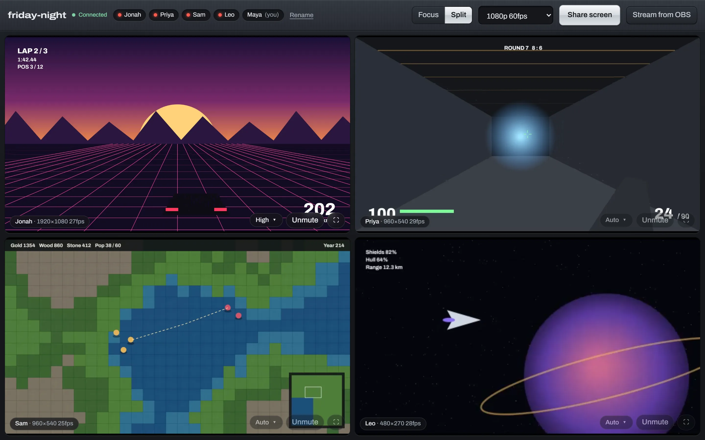

# stream

Private rooms for watching each other's games, at the quality you actually play at.



Send friends a link. Everyone in the room can share a screen, a game window or an OBS feed at the same time, up to 4K or high frame rates, and each viewer picks how they watch: one stream large or several side by side. It runs on your own Cloudflare account, so there's no subscription and no per-seat fee, and most friend groups stay inside Cloudflare's free allowance.

[](https://deploy.workers.cloudflare.com/?url=https://github.com/Andrew1431/stream-right)

- **Everyone can stream at once.** Focus on one stream with the others as thumbnails, or split the screen between them.
- **Quality per viewer.** Streams are sent as simulcast (full, half and quarter size). Each tile picks the layer that fits its size, or you choose High, Medium or Low for that tile.
- **Browser or OBS.** Share straight from the browser, or stream from OBS over WHIP with hardware encoding, game audio only, and no Chrome capture throttling.
- **Invite links are the keys.** The room token lives in the link's `#fragment`, so it never reaches server logs. Rotate a link to kick everyone and revoke it.
- **No accounts.** Type a name and you're in.

## What it costs

You pay Cloudflare directly, only for what's watched.

| | Free each month | After that |
|---|---|---|
| Realtime SFU (the video relay) | 1,000 GB delivered to viewers | $0.05 per GB |
| Workers + Durable Objects (the site and rooms) | Free plan limits are plenty for friends | |

Uploading (streaming) is free. You're charged for what each viewer receives, roughly:

| Watching | Per viewer per hour |
|---|---|
| 1080p60 | ~3 GB |
| 1440p60 | ~4 GB |
| 4K60 | ~8 GB |
| A small thumbnail | ~0.3 GB |
| Tab hidden (audio only) | ~0.05 GB |

Five friends each watching one 1080p60 stream for a 5-hour evening is about 70 GB, so 1,000 GB covers a dozen or so evenings a month. Idle rooms and a stream nobody is watching cost nothing.

To get a heads-up before spending anything, add a **Usage Based Billing** notification under **Notifications** in the Cloudflare dashboard.

## Set it up

You need a Cloudflare account (free). Cloudflare asks for a payment method before it turns on Realtime, even though you won't be charged inside the free allowance.

### 1. Create a Realtime app

1. In the [Cloudflare dashboard](https://dash.cloudflare.com), go to **Realtime → Serverless SFU** and create an app.
2. Keep the page open: you need its **App ID** and **App Secret** next.

### 2. Deploy

**One click:** press **Deploy to Cloudflare** above. It copies this repository to your GitHub account, asks for the three secrets below, and deploys. Future pushes to your copy redeploy automatically.

**Or from your computer** (Node 22+):

```bash
git clone https://github.com/Andrew1431/stream-right
cd stream-right
npm install
npx wrangler login
npx wrangler secret put CREATOR_KEY
npx wrangler secret put REALTIME_APP_ID
npx wrangler secret put REALTIME_APP_SECRET
npm run deploy
```

| Secret | What it is |
|---|---|
| `CREATOR_KEY` | A password for making rooms. Use a long random string, e.g. from `openssl rand -base64 32`. |
| `REALTIME_APP_ID` | The App ID from step 1. |
| `REALTIME_APP_SECRET` | The App Secret from step 1. |

Your site is now at `https://stream.<your-subdomain>.workers.dev`.

### 3. Make a room

Open the site, paste your creator key, type a room name and press **Create**. Copy the invite link and send it to your friends. Anyone with the link can join; nobody else can.

**Rotate link** makes a new link and disconnects everyone holding the old one, OBS streams included.

### Use your own domain (optional)

If your domain's DNS is on Cloudflare:

```bash
cp .env.example .env    # set CUSTOM_DOMAIN=stream.example.com
npm run deploy
```

Or add it in the dashboard under your Worker's **Settings → Domains & Routes**.

### Who can make rooms

Set `ROOM_CREATION` in `wrangler.jsonc`:

- `"key"` (default): you need the creator key to make a room. Good when one person runs the server and hands out links.
- `"open"`: anyone who knows the site's address can make their own rooms. Good for a friend group sharing one server.

Either way, joining a room always needs its invite link, and only the person who made a room (that browser) or someone with the creator key can rotate its link. Open mode means strangers who find the address could make rooms and stream on your bill, so keep the address among friends and set up the billing notification above.

## Streaming from OBS

Browser sharing works anywhere, but Chrome throttles capture when the game has focus and can't use your GPU encoder as well as OBS can. OBS 30 or newer streams straight into a room over WHIP.

1. In the room, click **Stream from OBS** to get your server URL and token.
2. **Settings → Stream:** Service **WHIP**, paste the **Server** and **Bearer Token**. On OBS 32+, set **Simulcast → Total Layers: 3** so viewers can get smaller copies.
3. **Settings → Output** (Output Mode: Advanced → Streaming):
   - **Video Encoder:** NVIDIA NVENC H.264, AMD HW H.264 or QuickSync H.264. Not HEVC or AV1; not every browser can play those over WebRTC.
   - **Rate Control:** CBR, **Bitrate** about 8000 Kbps for 1080p60, 12000 for 1440p60, 20000 for 4K60.
   - **Keyframe Interval:** 1 s, so viewers who join or switch quality see the picture straight away.
   - **Max B-frames:** 0. WebRTC doesn't support them.
4. **Settings → Video:** set the output resolution and FPS you want to send (1440p at 120 works if your upload can carry it).
5. Add a **Game Capture** source and press **Start Streaming**. Your stream shows up in the room as "*your name* (OBS)".

**Keep voice chat out of the stream:** in **Settings → Audio**, set **Desktop Audio** to Disabled, then add an **Application Audio Capture** source for the game (Windows 10 2004+). Discord and music stay off the stream without extra software.

Each person gets their own token from their room's OBS panel. A token stops working when the room's link is rotated; **Make a new token** in the panel replaces just yours.

## Troubleshooting

**Stuck on "Reconnecting".** A browser extension (ad or privacy blockers especially) may be blocking WebSockets. Try a private window; if that works, allow the site in the extension.

**"Streaming isn't configured on the server yet."** `REALTIME_APP_ID` or `REALTIME_APP_SECRET` is missing. Set both and deploy again.

**A stream is choppy at high resolution.** Check upload speed first: the sender needs a bit more upload than the bitrate. 4K60 needs about 25 Mbps. In the browser, pick a lower resolution, or use OBS with a hardware encoder.

**High/Medium/Low don't change an OBS stream.** That stream has one layer. Set **Total Layers: 3** in OBS (version 32+) and restart the stream.

**Quality drops when the viewer switches tabs.** By design: after 15 seconds hidden, a tab drops to audio only to save bandwidth, and comes back when you return.

## Develop

```bash
npm install
cp .dev.vars.example .dev.vars   # fill in the same three secrets
npm run dev                       # http://localhost:5173
```

Run `npm run cf-typegen` after changing `wrangler.jsonc` or `.dev.vars`.

How it fits together: a Worker serves the React app and an API, each room is a Durable Object holding the members list and a WebSocket per person, and Cloudflare Realtime relays the media. Browsers publish to and pull from the SFU directly; the room only brokers which tracks exist. OBS talks to the room's WHIP endpoint, which creates the SFU session on its behalf.

```
shared/protocol.ts   messages between browser and room
worker/index.ts      HTTP routes: create room, WebSocket, WHIP
worker/room.ts       the Room Durable Object
src/RoomPage.tsx     the room UI
src/media.ts         publishing and subscribing over WebRTC
```

## License

[MIT](LICENSE)
